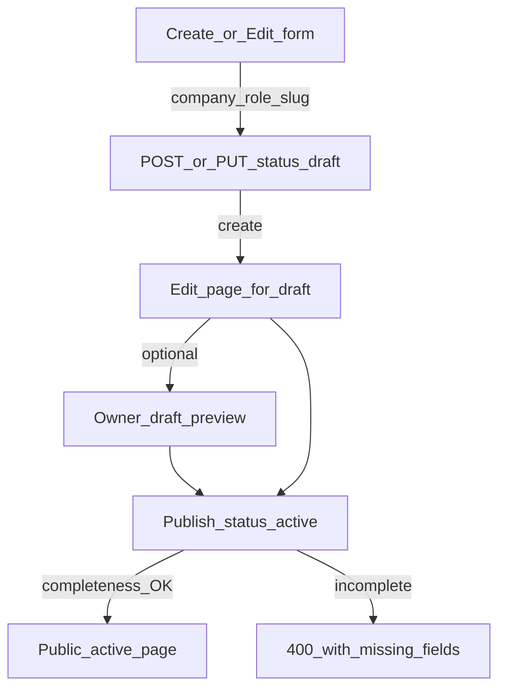

# Incomplete server drafts + publish completeness gate (F40)

**Status:** Implemented (locked product rule below).  
**Backlog:** `F40-124` · migration `030_applications_cv_url_nullable.sql`  
**Journal:** [DEVELOPMENT_JOURNAL.md](../retrospectives/DEVELOPMENT_JOURNAL.md)

---

## Locked product rules

| Action | Required |
| ------ | -------- |
| **Save draft** (create or edit while `status = draft`) | **Company**, **Role**, and a ready **link ending / shareable link** (auto-filled from company + role). Résumé, YouTube, and names are optional. |
| **Publish** / create or save as **`active`** | Full set: company, role, share link, first name, last name, résumé, YouTube intro |
| **Save while already `active`** | Same full set (cannot blank out a live app) |
| Public recruiters | Unchanged — drafts stay unavailable |

Owner draft preview may show placeholders when résumé or video is missing.

---

## Implementation notes

- Create schema requires company, role, slug; `cv_url` may be `null`; `video_url` may be `""`.
- `applications.cv_url` is nullable so multiple tailored drafts without a CV do not collide on the unique tailored URL index.
- Selecting **Upload one for this role** without a file yet is a valid draft: the form must not send a leftover library résumé URL as tailored (that triggered ownership 400s). Publish still requires a real résumé.
- Dashboard **CV missing** is only for a saved URL whose object is gone — not for drafts that simply have no résumé yet (`cv_exists` omitted when `cv_url` is null).
- `getApplicationPublishBlockers` gates `status → active` on PUT (including publish-only `{ id, status: "active" }`) and create-as-active.
- Form: draft save enables when company + role + slug are ready; live edits keep the full gate.

