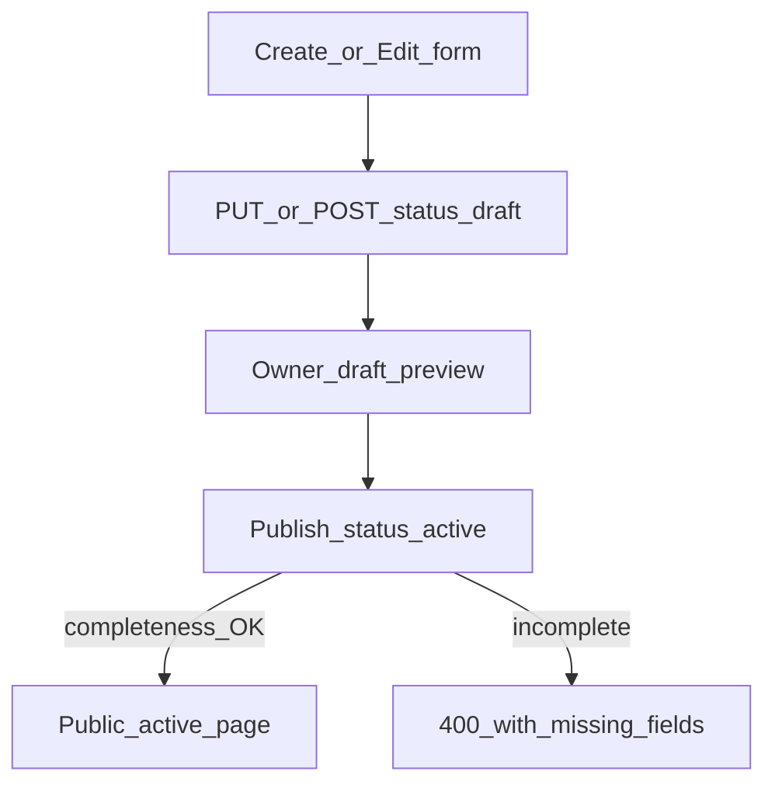

# Incomplete server drafts + publish completeness gate (F40)

**Status:** Planned — **not started**. Separate PR from F35 form-layout work.  
**Backlog:** `F40-124` · PR group `feat/f40-incomplete-draft-saves`  
**Journal:** [DEVELOPMENT_JOURNAL.md](../retrospectives/DEVELOPMENT_JOURNAL.md) (2026-10-19)

Parked implementation plan. Revisit after F35 layout decision so Save/publish behavior is not changed under an active A/B test.

---

## Problem

Today, create cannot persist a real application until company, role, slug, CV, and video all pass client + API checks ([`lib/validation/application.ts`](../../lib/validation/application.ts) `applicationCreateSchema`; [`ApplicationForm`](../../components/forms/ApplicationForm.tsx) `canSubmit`). LocalStorage draft (F15) is not a dashboard application. Meanwhile **Publish** is only `PUT { id, status: "active" }` ([`publishApplication`](../../lib/api/applications.ts)) with **no** completeness check — so relaxing create without hardening publish would be unsafe.

DB columns `company`, `role`, `slug`, `cv_url`, `video_url` are `NOT NULL` ([`001_initial_schema.sql`](../../supabase/migrations/001_initial_schema.sql)). Empty string `''` works for missing company/role/slug/video, but **`cv_url = ''` collides** with partial unique index `applications_user_id_tailored_cv_url_key` on `(user_id, cv_url) WHERE cv_type = 'tailored'` ([`026_applications_tailored_cv_url_unique.sql`](../../supabase/migrations/026_applications_tailored_cv_url_unique.sql)) — `cv_type` defaults to `'tailored'`, so a user’s second CV-less draft would fail insert. For missing draft CVs prefer **`cv_url` NULL** (index allows NULL) via a nullable `cv_url` migration, **or** exclude empty URLs from that index. Do not store `''` for missing tailored `cv_url`.

---

## Product rules

| Action | Allowed when incomplete? |
| ------ | ------------------------ |
| Create / update as **`status: draft`** | Yes — missing company/role/CV/video/slug OK (slug auto-filled if needed) |
| Save while already **`active`** | No — must keep full required set (cannot blank out live apps) |
| **Publish** / restore to **`active`** | No — server rejects until all required fields are valid |
| Public recruiters | Unchanged — drafts stay unavailable |

**UI (simple):** Keep one primary button per flow.

- **Create:** `Save & Preview` always enabled (not gated on `canSubmit`). Saves `status: draft` with whatever is filled; then navigates to preview when a shareable slug + public id exist (same as today). Incomplete preview is OK (owner-only draft banner).
- **Edit (draft):** `Save Application` always enabled; stays draft.
- **Edit (active):** Keep strict required validation before save.
- F35 Continue gating can stay for guided progress, but must not block Save on Review for drafts.

No separate “Save draft” button in this pass (avoids two competing CTAs). Leave-dialog “keep draft and leave” remains out of scope.

---

## Implementation sketch

### 1. Shared completeness helper

Add `getApplicationPublishBlockers(app)` (e.g. in [`lib/validation/application.ts`](../../lib/validation/application.ts)): missing/blank company, role, slug (format), `cv_url` (non-empty; primary id when `cv_type=primary`), `video_url` (valid URL as today). Reuse from API publish gate + optional client messaging.

### 2. API validation

- **POST create:** If `status` is `draft` (default) or omitted → relax zod so company/role/cv_url/video_url may be empty; if slug missing/blank, server generates a unique placeholder (e.g. `draft-{shortid}`). Persist missing CV as **`cv_url: null`** (after nullable migration) or ensure empty URLs are excluded from the tailored unique index — not `''`. Skip tailored-CV ownership / in-use checks when `cv_url` is null/empty. If caller sends `status: "active"`, keep **strict** create schema.
- **PUT update:** When resulting status would be `active`, after merge with existing row run completeness helper; 400 listing what’s missing. When staying as `draft`, allow empties. Publishing-only body `{ id, status: "active" }` must load the row and run the same gate (fixes the current hole).

### 3. Client form

- Split **draft save readiness** vs **publish readiness**.
- Draft save: enable primary submit even when required fields empty; validate format only for filled fields.
- Active edit: keep current required errors.
- [`DraftPreviewBanner`](../../components/view/DraftPreviewBanner.tsx) / dashboard Publish: surface incompleteness errors clearly.

### 4. Tests + docs

- Unit tests for draft-relaxed create + publish blockers; API tests for incomplete draft OK / publish incomplete → 400.
- Update user guide / F16 notes / manual expectations when implementing.

### 5. Out of scope for F40

- Leave-confirm third option (“keep local draft and leave”)
- Profile preference for form layout
- Making company/role/slug/video_url nullable (missing draft **`cv_url` NULL** is in scope if chosen over an index change)
- Auto-publish or changing public `/view` stub behavior for drafts

---

## Risk notes

- Placeholder slugs may appear on the dashboard until the user sets a real one — acceptable before publish.
- Owner preview of incomplete apps must not crash (verify empty CV/video paths).
- Prefer shipping **after F35** layout pick so Save button semantics are not A/B’d at the same time.
